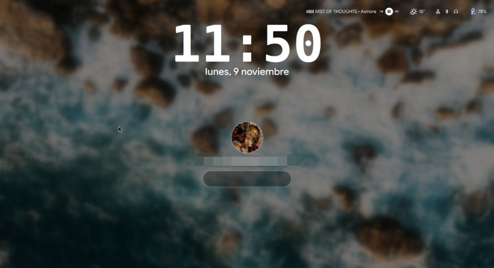

# Apple Lock Auth

Complemento de la pantalla de bloqueo de DMS (DankMaterialShell / Dux Shell) para Hyprland. Muestra el avatar, lo eleva al interactuar y abre la barra de contraseña. No es un plugin de `hyprpm`: vive en la lista de complementos de DMS.



Versión actual: `1.2.2`. Requiere DMS `>= 2.0.0`.

## Estructura

```
apple-lock-auth/
├── plugin.json                         # manifiesto que lee DMS
├── AppleLockAuth.qml                   # widget de desbloqueo
├── ui/
│   └── AppleLockAuthSettings.qml       # panel de Ajustes
├── registry.json                       # datos propios del registro (categoría, compositor)
├── scripts/
│   └── build-registry-entry.py         # genera la entrada del registro
└── .github/workflows/
    └── registry-entry.yml              # la publica como artefacto
```

`plugin.json` apunta el escritorio a `./AppleLockAuth.qml` y los ajustes a `./ui/AppleLockAuthSettings.qml`. El id del complemento es `appleLockAuth`. La carpeta instalada debe llamarse igual.

## Instalación

1. Copia o clona el repositorio dentro de los complementos de DMS:

```bash
mkdir -p ~/.config/dms/plugins
git clone <url-de-este-repo> ~/.config/dms/plugins/appleLockAuth
```

Si todavía no hay remoto, copia la carpeta:

```bash
cp -a /home/ernest/Documentos/GitHub/apple-lock-auth ~/.config/dms/plugins/appleLockAuth
```

2. Recarga el complemento:

```bash
dms ipc call plugin-scan rescan appleLockAuth
```

3. En DMS abre **Ajustes → Lock Screen → Widgets** y deja activo el widget cuyo tipo es `appleLockAuth`. Si el campo de contraseña nativo sigue activo, apágalo para que solo este widget reciba el teclado.

4. Los controles también están en **Ajustes → Plugins → Apple Lock Auth**. Un cambio ahí se escribe en `plugin_settings.json` y en la instancia del lock screen.

## Configuración

Valores que quedan aplicados al instalar el ejemplo de abajo:

| Ajuste | Clave | Valor |
| --- | --- | --- |
| Estilo de barra | `barStyle` | `apple` |
| Escala general | `generalScale` | `115` |
| Avatar | `avatarSize` | `96` |
| Ancho de barra | `barWidth` | `240` |
| Alto de barra | `barHeight` | `44` |
| Botones nativos | `showActionButtons` | `true` |

`barStyle` acepta `apple`, `expressive`, `pill`, `dots`, `minimal` y `ring`.

En `~/.config/dms/plugin_settings.json`:

```json
"appleLockAuth": {
  "enabled": true,
  "barStyle": "apple",
  "avatarSize": 96,
  "generalScale": 115,
  "barWidth": 240,
  "barHeight": 44,
  "showActionButtons": true
}
```

En `lockScreenWidgetInstances` de `~/.config/dms/settings.json`, la instancia de autenticación queda así:

```json
{
  "id": "lock_auth",
  "widgetType": "appleLockAuth",
  "enabled": true,
  "config": {
    "displayPreferences": ["all"],
    "syncPositionAcrossScreens": true,
    "barStyle": "apple",
    "avatarSize": 96,
    "generalScale": 115,
    "barWidth": 240,
    "barHeight": 44,
    "showActionButtons": true
  }
}
```

## Entrada para el registro de complementos

DMS marca como *not in registry* todo plugin que no tenga un JSON en un registro. El registro oficial es [dux-plugin-registry](https://github.com/duxlabs-dev/dux-plugin-registry): un repositorio git con un archivo por complemento en `plugins/`.

La acción `.github/workflows/registry-entry.yml` corre en cada push a `main` o `master`, y también a mano. Lee `plugin.json` y `registry.json`, arma el manifiesto y lo sube como artefacto `dms-registry-entry`. El nombre del archivo es `{usuario}-apple-lock-auth.json`.

En `main`, esa misma acción publica la release `vX.Y.Z` tomada de `plugin.json`. Adjunta el JSON del registro y un zip `appleLockAuth-X.Y.Z.zip`. Si esa versión ya tiene tag en otro commit, no publica nada: sube `version` en `plugin.json` y vuelve a empujar `main`.

Para generarlo en local, con la URL pública del repositorio:

```bash
python3 scripts/build-registry-entry.py \
  --repo https://github.com/USUARIO/apple-lock-auth \
  --owner USUARIO \
  --out dist
```

El resultado es `dist/usuario-apple-lock-auth.json`. Para que aparezca en **Ajustes → Plugins → Browse**:

1. Haz un fork de `duxlabs-dev/dux-plugin-registry`.
2. Copia ese JSON a `plugins/`.
3. Abre el pull request. El `id` y el `name` tienen que coincidir con `plugin.json`.

Hasta que ese PR se mezcle, el complemento se instala igual con la copia en `~/.config/dms/plugins/appleLockAuth`. El registro solo lo agrega al catálogo.
